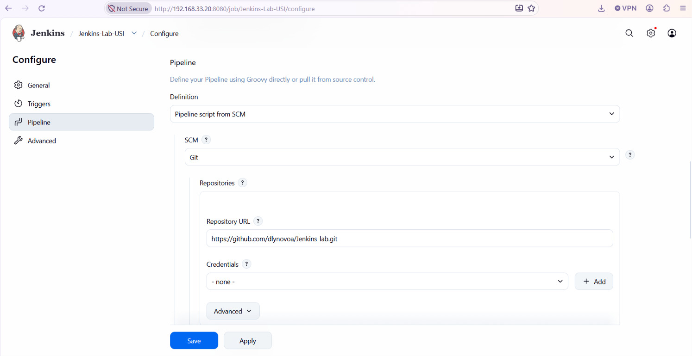
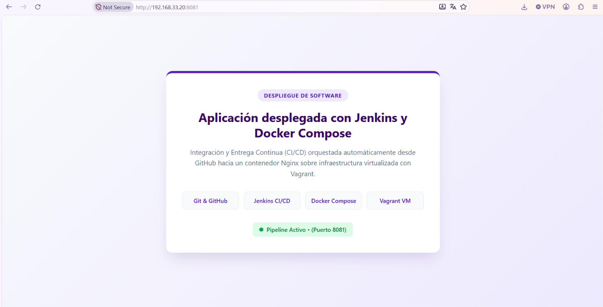

# Laboratorio CI/CD: Orquestación con Jenkins, Docker Compose y Vagrant

Implementación de un flujo automatizado de Integración y Entrega Continua (**CI/CD**) utilizando **Jenkins** como orquestador central sobre una máquina virtual aprovisionada mediante Infraestructura como Código (**Vagrant**), empaquetando y desplegando una aplicación web estática con **Docker** y **Docker Compose**.

---

## 1. Flujo Visual del Pipeline (Código $\rightarrow$ Producción)

El siguiente diagrama muestra en qué etapa interviene cada archivo del repositorio desde que se realiza un cambio local hasta su publicación en el contenedor:


---

## 2. Estructura del Repositorio y Mapa de Puertos

### Archivos del proyecto
```text
Jenkins_lab/
├── app/
│   └── index.html          # Interfaz web estática desplegada en Nginx
├── scripts/
│   └── images/             # Capturas de evidencia del laboratorio
├── test/
│   └── run-tests.sh        # Script Bash de validación de integridad (Quality Gate)
├── .gitattributes          # Fuerza saltos de línea LF en scripts .sh
├── .gitignore              # Excluye metadatos locales (.vagrant/)
├── compose.yaml            # Orquestación del contenedor web y red aislada
├── Dockerfile              # Construcción de la imagen inmutable sobre nginx:1.27-alpine
├── Jenkinsfile             # Definición declarativa del Pipeline CI/CD
├── provision.sh            # Script de aprovisionamiento (Java 21, Docker y Jenkins)
└── vagrantfile             # Definición de hardware virtual y red privada
```

### Separación de puertos en la VM (`192.168.33.20`)

| Servicio | Puerto | URL de Acceso | Función |
| :--- | :---: | :--- | :--- |
| **Jenkins Controller** | `8080` | `http://192.168.33.20:8080` | Panel de control, gestión de credenciales y ejecución de pipelines. |
| **Aplicación Web (Nginx)** | `8081` | `http://192.168.33.20:8081` | Contenedor Docker resultante del proceso de despliegue continuo. |

---

## 3. Aprovisionamiento de Infraestructura (Vagrant)

### Requisitos previos
* **Oracle VirtualBox** instalado.
* **HashiCorp Vagrant** instalado.
* **Git** configurado en el equipo anfitrión.

### Levantamiento de la máquina virtual
Desde PowerShell en la raíz del proyecto, ejecutar:

```powershell
# Crea la VM Ubuntu 22.04, configura la IP 192.168.33.20 y ejecuta provision.sh
vagrant up
```

Al finalizar el aprovisionamiento, la consola mostrará la contraseña inicial de administrador de Jenkins (también consultable dentro de la VM mediante `vagrant ssh`):

```bash
sudo cat /var/lib/jenkins/secrets/initialAdminPassword
```

### Comandos útiles de ciclo de vida de la VM
```powershell
vagrant status       # Verifica el estado actual de la máquina virtual
vagrant ssh          # Inicia sesión por terminal dentro de Ubuntu
vagrant halt         # Apaga la VM de forma segura conservando el estado
vagrant destroy -f   # Elimina por completo la VM y su disco virtual
```

---

## 4. Configuración del Pipeline en Jenkins

1. Acceder a `http://192.168.33.20:8080`, desbloquear Jenkins con la clave inicial e instalar los **plugins sugeridos** (*Install suggested plugins*).
2. Crear un nuevo proyecto desde **+ New Item** con el nombre `Jenkins-Lab-USI` seleccionando el tipo **Pipeline**.
3. En la sección **Triggers**, habilitar **Poll SCM** con la expresión cron:
   ```text
   H/2 * * * *
   ```
4. En la sección **Pipeline**:
   * **Definition:** `Pipeline script from SCM`
   * **SCM:** `Git`
   * **Repository URL:** `https://github.com/dlynovoa/Jenkins_lab.git`
   * **Branch Specifier:** `*/main`
   * **Script Path:** `Jenkinsfile`
5. Guardar los cambios (**Save**) y ejecutar la primera construcción mediante **Build Now**.



---

## 5. Pruebas de Verificación y Quality Gates

### Prueba 1: Despliegue continuo automático (Camino Feliz)
1. Modificar cualquier texto o estilo en `app/index.html`.
2. Subir el cambio al repositorio remoto:
   ```bash
   git add app/index.html
   git commit -m "Actualiza contenido de la interfaz"
   git push origin main
   ```
3. Esperar el ciclo de sondeo de **Poll SCM** (máximo 2 minutos) y recargar `http://192.168.33.20:8081` para verificar la actualización automática sin intervención manual en el servidor.



### Prueba 2: Bloqueo preventivo ante código defectuoso (Quality Gate)
1. Editar `app/index.html` eliminando la etiqueta principal `<h1>` y realizar `git push origin main`.
2. Jenkins descargará el commit y ejecutará `test/run-tests.sh`.
3. Al no encontrar `<h1>`, el script devolverá `exit 1`, marcando la etapa **Test** en rojo y abortando **Build & Deploy**.
4. Al recargar `http://192.168.33.20:8081`, la versión anterior permanece activa y sin caídas.

### Prueba 3: Verificación por línea de comandos
Dentro de la máquina virtual (`vagrant ssh`), comprobar el contenedor activo y la respuesta HTTP:

```bash
docker ps
curl -I http://localhost:8081
```
